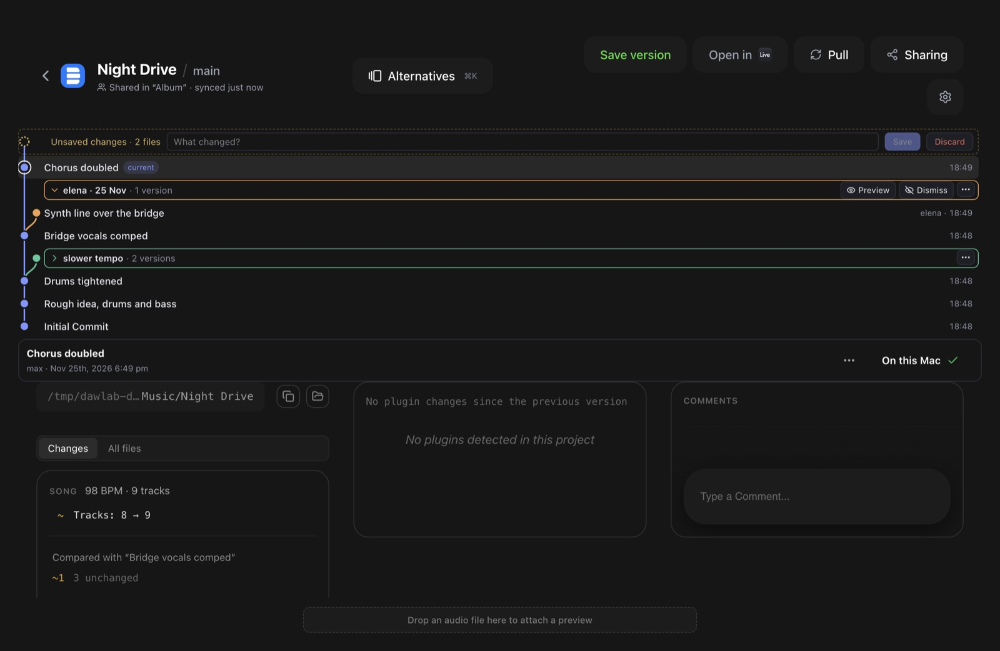
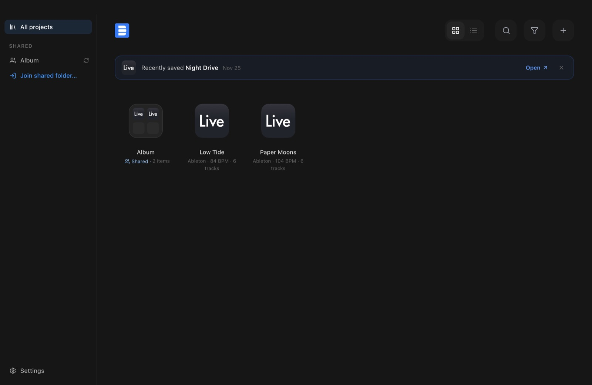
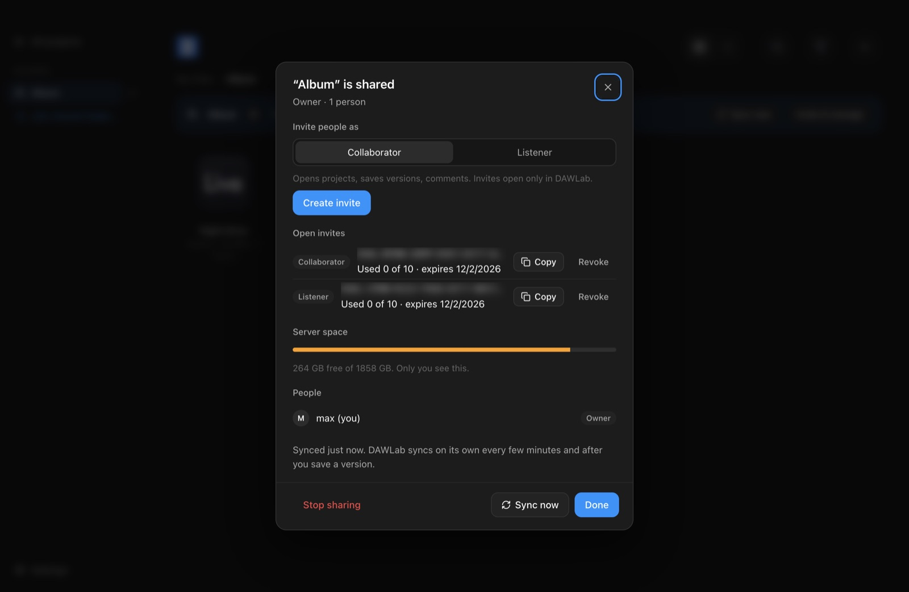
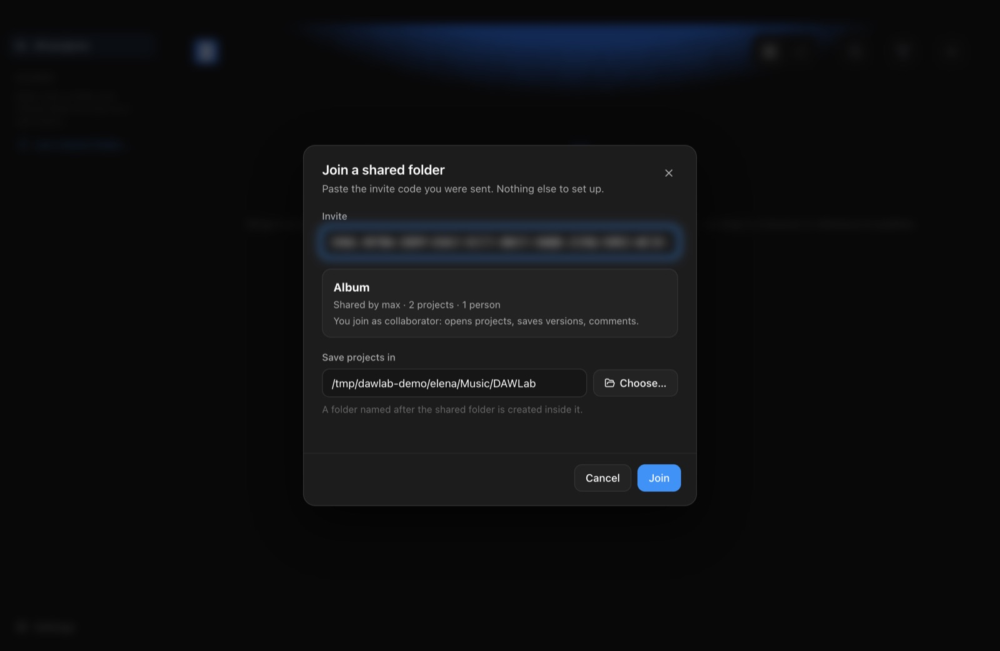
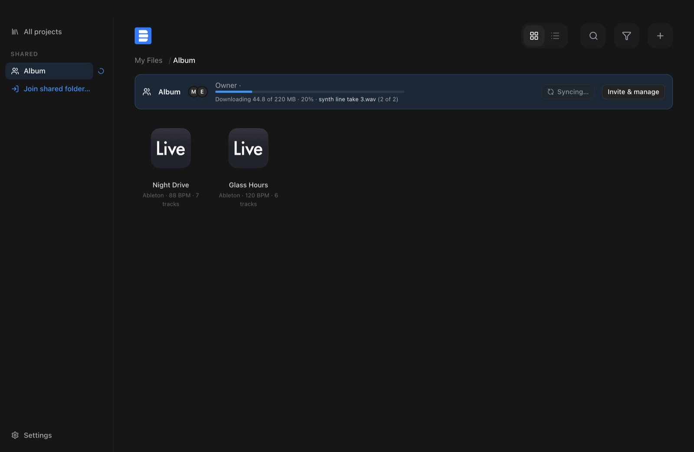
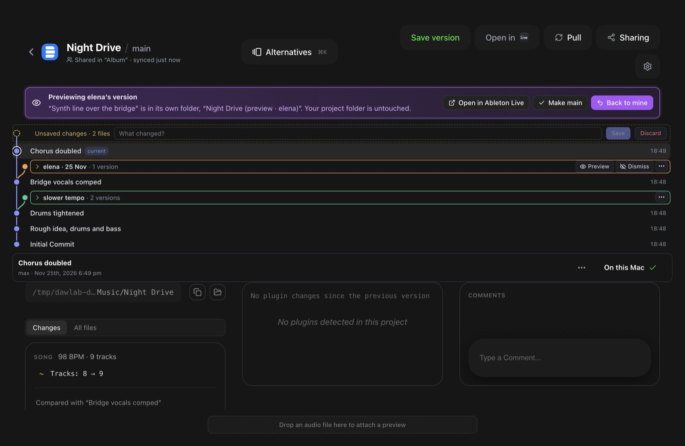

# DAWLab

**Version control for music producers.** DAWLab saves versions of your DAW projects, shows their history, lets you try ideas on alternatives and go back to any version. It works on your Mac with no account. When you want to work with others, share a folder through your own DAWLab Hub.

Works with Ableton Live, Logic Pro, FL Studio, Pro Tools and Reaper projects.



---

## Install

1. Download `DAWLab-Mac-arm64-<version>-Installer.dmg`, open it and drag DAWLab to Applications.
2. The app is not signed by Apple yet, so macOS blocks the first launch. Right-click DAWLab in Applications, choose **Open**, then **Open** again. If macOS says the app "is damaged", run this once in Terminal:

   ```bash
   xattr -dr com.apple.quarantine /Applications/DAWLab.app && codesign --force --deep --sign - /Applications/DAWLab.app
   ```

## Projects and versions



- **Add a project**: click **+** in the Library and pick the project folder (or drag it in). DAWLab saves the first version.
- **Save a version**: when the project folder changes, an **Unsaved changes** row appears at the top of the history with the number of changed files. Describe what changed and click **Save**.
- **Discard**: the same row has **Discard**, which puts the folder back to the last saved version. Your current files go to the Trash first, in a folder named after the project, so you can still get them back.
- **Restore**: click a version on the rail, then **Restore** in the bar below. The folder becomes an exact copy of that version. Files the version doesn't have go to the Trash.
- **Nothing is lost when you switch**: before Restore, Make main or Discard changes the folder, DAWLab keeps any unsaved work as a version marked **Kept automatically**. **Bring back** on it returns everything as it was.
- **Alternatives**: try an idea without touching the main line. Use **Alternatives** (or Cmd+K) to create or switch. On the rail, each alternative is folded into one row where it split off; open it to see its versions.

## Sharing a folder



1. Connect your hub once in **Settings > DAWLab server** (address and hub key).
2. Right-click a Library folder and choose **Share**. Every project in it is uploaded with its versions.
3. Create an invite as **Collaborator** (opens projects, saves versions, comments) or **Listener** (plays previews and comments). Send the code privately.
4. The folder owner always sees the open invite codes in the Share dialog. **Revoke** cancels a code; people who already joined stay. To remove someone, use the button next to their name.

### Joining with a code



Click **Join shared folder...** in the sidebar and paste the code. DAWLab shows what the folder contains, then downloads its projects with their full history. A new code for a folder you are already in syncs that folder instead of joining twice.

### Pull and Sync



DAWLab syncs shared folders every few minutes and after you save. **Pull** in a project, or **Sync now** on the folder, gets everyone's latest versions right away. Large files show their progress: size done, percentage and the file name.

If access to a folder is closed (you were removed, or the owner stopped sharing), the folder says so and keeps your copies. Enter a new code or stop syncing it.

## Parallel versions

When two people save on top of the same version, nothing is overwritten. The second save goes into a **parallel version**, an alternative named after its author, and DAWLab tells you where it went.



- On the rail, a parallel version is folded into one outlined row where it split off, with Preview, Dismiss and a ⋯ menu (Listen, Compare, Make main). Open it to see its versions.
- **Preview** lays the whole project out in a folder of its own next to yours and opens it in your DAW. Your folder is not touched. **Back to mine** moves the preview folder to the Trash.
- **Make main** continues your line with their version. Your version stays in the history.
- **Dismiss** hides the notice for you, with a short reason that the author sees as a comment. The alternative stays for everyone. A newer version in it brings the notice back.

## Run your own hub

The hub is a small server that stores shared folders. It has no web pages: without the hub key or a member's token every request gets an empty 404.

**On Render:** create a Blueprint from this repository. `render.yaml` sets up the service with a disk at `/data` and generates `HUB_CREATE_KEY`. Keep the key in Render's environment settings or a secrets manager, never in the repository, and enter it once in DAWLab's settings. On the free instance the disk is wiped on restart, so use an S3-compatible bucket instead.

**Elsewhere:**

```bash
HUB_CREATE_KEY=<your-secret> docker compose up -d
```

| Variable | Meaning |
| --- | --- |
| `HUB_CREATE_KEY` | Required, 12+ characters. Lets DAWLab create shared folders on the hub. |
| `DATA_DIR` | Where data is stored (`/data` on Render and in Docker). |
| `S3_BUCKET`, `S3_ENDPOINT`, `S3_REGION`, `S3_PREFIX`, `S3_FORCE_PATH_STYLE` | Store data in an S3-compatible bucket instead. Credentials come from `AWS_ACCESS_KEY_ID` and `AWS_SECRET_ACCESS_KEY`. |
| `PUBLIC_URL` | Public address, if a proxy changes the Host header. |
| `MAX_UPLOAD_MB` | Largest single file accepted (default 2048). |

---

## Build from source

Requires Node.js 22 or newer (DAWLab uses [mise](https://mise.jdx.dev) to pin it) and npm.

```bash
npm install
npm run dev        # the app with hot reload
npm run build      # installers in release/<version>/
```

On macOS, build an unsigned DMG with:

```bash
npm run build:renderer && CSC_IDENTITY_AUTO_DISCOVERY=false npx electron-builder --mac --arm64
```

## Development

### Scripts

| Command | Description |
|---|---|
| `npm run dev` | Start the Electron app in development with hot reload |
| `npm run build` | Type-check, bundle, and package desktop installers |
| `npm run build:renderer` | Bundle renderer + main without packaging |
| `npm run lint` | ESLint (`--max-warnings 0`) |
| `npm run test:unit` | Run the test suite once (CI mode) |
| `npm run test` | Run tests in watch mode |
| `npm run test:coverage` | Run tests with a coverage report |

### Tech stack

- **[Electron](https://www.electronjs.org/) 40**: desktop shell
- **[React](https://react.dev/) 18** + **[TypeScript](https://www.typescriptlang.org/)**: UI
- **[Vite](https://vite.dev/) 7**: build tooling (via `vite-plugin-electron`)
- **[Tailwind CSS](https://tailwindcss.com/)**: styling
- **[Vitest](https://vitest.dev/)**: testing

### Project structure

```
electron/            Electron main process (Node.js)
  main.ts            IPC handlers and app lifecycle
  preload.ts         Secure contextBridge to the renderer
  dawvcs/            The DAWLab version-control engine
    core/            Content-addressable storage, registry, logs, DAW detection
    operations/      init, commit, rollback, branch, clean, scan, ...
  workers/           Worker threads (metadata extraction, plugin scanning)
src/                 React renderer (no Node.js access)
  pages/             Library, History, Settings
  components/        UI components
  hooks/             Data + action hooks that call into IPC
  types/             Shared TypeScript types
```

The renderer never touches the filesystem directly: all disk and VCS work happens in the main process and is reached through typed IPC calls.

---

## Contributing

Contributions are welcome. Please run `npm run lint` and `npm run test:unit` before opening a pull request, and keep changes focused.

## License

Licensed under the **[PolyForm Noncommercial License 1.0.0](LICENSE)**.

You are free to **use, modify, and share** DAWLab for any **noncommercial** purpose: personal projects, learning, research, education, and nonprofit or government use. **Commercial use is not permitted**: you may not sell DAWLab, offer it as a paid product or service, or otherwise use it to make money. See the [LICENSE](LICENSE) file for the full terms.

> Note: this is a *source-available*, noncommercial license, not an OSI-approved open-source license (open-source licenses must permit commercial use).

Copyright © 2026 Oleg Mrynskyi.
